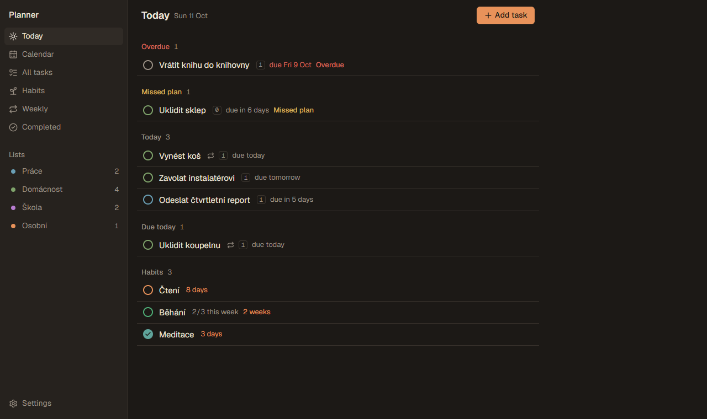
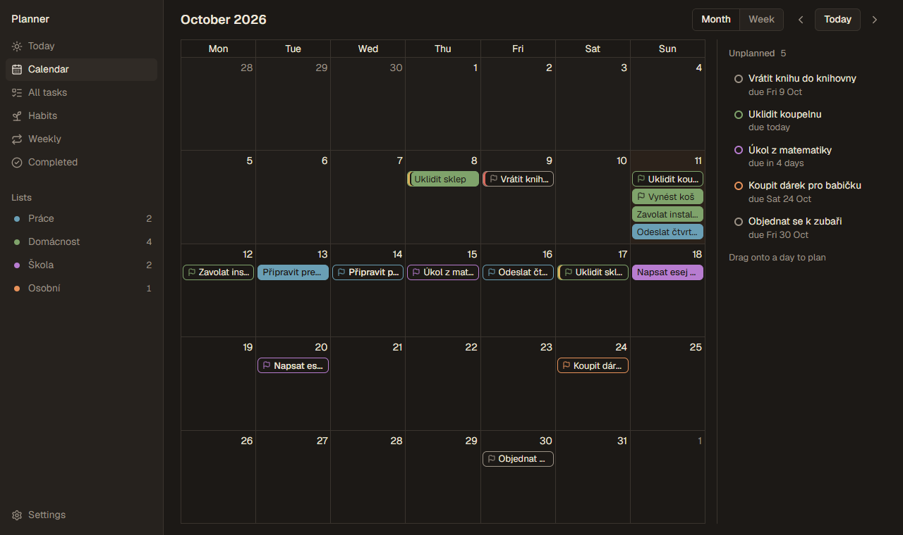
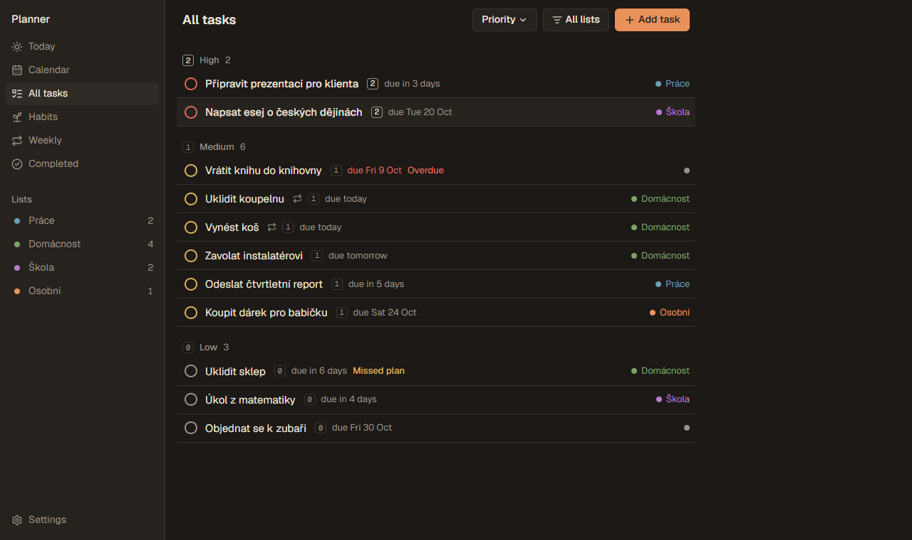
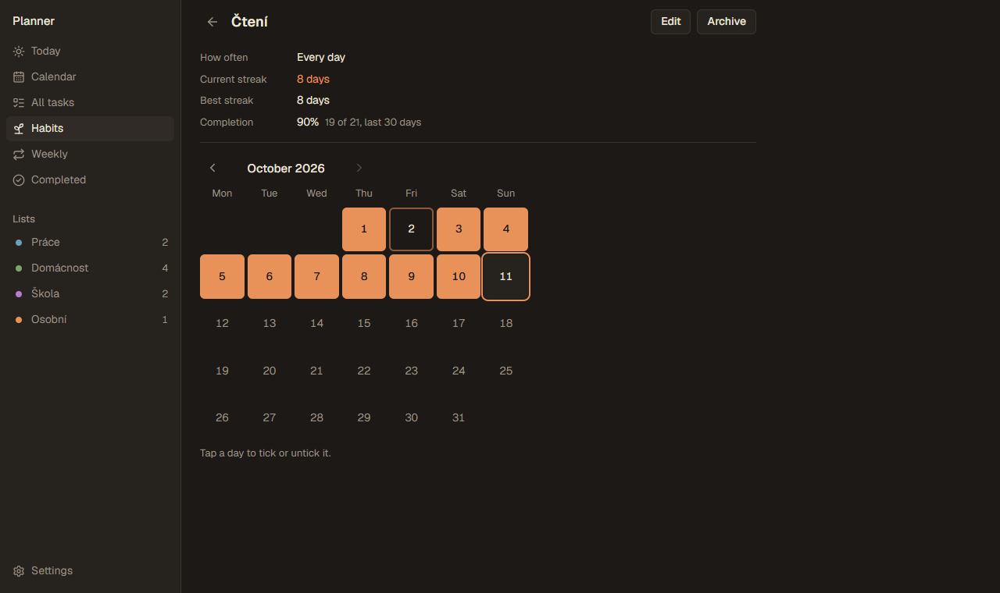
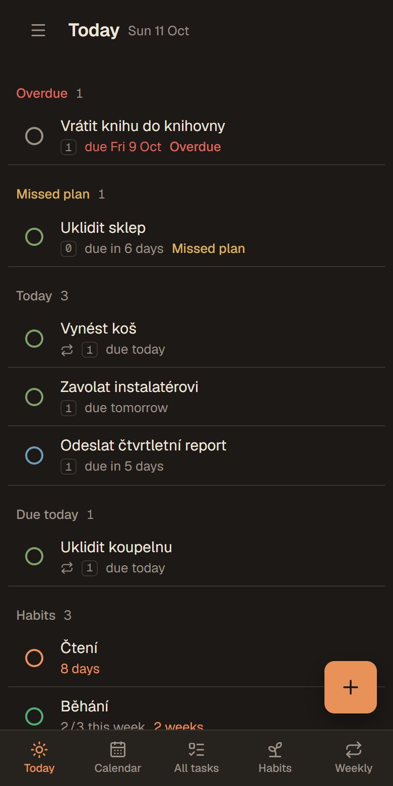
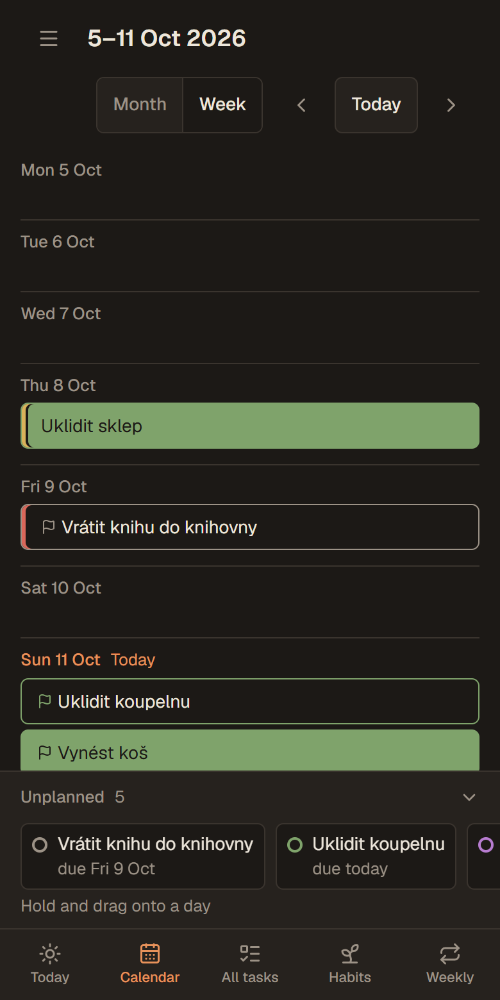

# Planner

A personal task planner for one person. Tasks have a required **deadline** and a **planned date**, which is the day you intend to work on them. Lists are color-coded. Overdue work is flagged but never moved automatically. Planner installs as an app on your phone and desktop (PWA) and runs entirely on Cloudflare's free tier.

Each deployment is single-user: you deploy your own copy and protect it with your own password.

> Status: Phases 1–4 are done: tasks and lists, Today, All tasks, Completed, a calendar with drag-to-plan, weekly tasks, habits with streaks, read-only offline use, and a Claude connector. See [SPEC.md](SPEC.md).

| Today | Calendar |
|---|---|
|  |  |
| **All tasks, sorted by priority** | **Habit detail** |
|  |  |

<p>
  
  
</p>

_Screenshots use made-up sample data. A new installation starts empty._

## How it works

- **One Cloudflare Worker** serves the React app as static files and runs the API under `/api`, so everything is on one origin.
- **Cloudflare D1** (SQLite) stores lists, tasks, weekly templates, habits and sessions. Migrations live in `migrations/`.
- **Weekly tasks** are created lazily when the app loads, one per template per week, so no scheduled job is needed.
- **Login** uses one password. Its PBKDF2 hash is stored as a Worker secret, never in the database or in this repo. After logging in, a device stays logged in for a year, and the session renews itself whenever you use it.
- **Offline** the app shows your last loaded data read-only. Changes need a connection.
- **Claude connector:** the same Worker serves an OAuth-protected MCP endpoint at `/mcp` ([Cloudflare's OAuth provider](https://github.com/cloudflare/workers-oauth-provider) plus the MCP SDK). Connections and tokens live in a KV namespace (`OAUTH_KV`). Claude follows the same task rules as the app.

```
src/
  client/   React app (screens, components, styles)
  worker/   Hono API, auth, Drizzle schema
  shared/   types and pure date/task logic shared by both (unit tested)
scripts/    set-password script
migrations/ SQL migrations for D1 (generated by drizzle-kit)
```

## Run locally

You need **Node.js 22 or newer** (`node -v` shows your version).

```bash
npm install                                # install dependencies
cp wrangler.example.jsonc wrangler.jsonc   # create your local config (gitignored)
npm run set-password -- --local            # choose a password for local use (saved to .dev.vars)
npm run db:migrate:local                   # create the tables in a local D1 database
npm run dev                                # start the app at http://localhost:5173
```

On Windows PowerShell, use `copy` instead of `cp`.

If PowerShell says _"npm.ps1 cannot be loaded because running scripts is disabled on this system"_, allow local scripts for your user once:

```powershell
Set-ExecutionPolicy -Scope CurrentUser -ExecutionPolicy RemoteSigned
```

Or, without changing the setting, type `npm.cmd` instead of `npm` (for example `npm.cmd run dev`).

`npm run dev` keeps running until you stop it (Ctrl+C). The app is only reachable at http://localhost:5173 while it runs.

The local database lives in `.wrangler/` and is separate from your deployed one. You don't need a real database ID to develop locally; the placeholder in `wrangler.jsonc` works.

## Run the tests

```bash
npm test             # all unit tests once
npm run test:watch   # re-run on file changes
npm run typecheck    # TypeScript check of client, worker and scripts
```

## Deploy your own

Follow these steps once. Each command has a one-line explanation.

### 1. Prerequisites

- **Node.js 22+**: install from [nodejs.org](https://nodejs.org).
- **Git**: to clone the repository.
- A **Cloudflare account**: free; created in the next step.

### 2. Create a Cloudflare account

1. Go to [dash.cloudflare.com/sign-up](https://dash.cloudflare.com/sign-up) and sign up with an email and password.
2. Confirm your email address from the email Cloudflare sends you.

You don't need a domain or a payment method. Workers and D1 are free up to generous daily limits.

### 3. Get the code

```bash
git clone https://github.com/<you>/<your-fork>.git planner   # download the code
cd planner                                                  # go into the project folder
npm install                                                 # install dependencies
```

### 4. Log the Cloudflare CLI in to your account

```bash
npx wrangler login
```

This opens a browser window where you allow Wrangler (Cloudflare's command-line tool) to access your account. Run `npx wrangler whoami` to check that it worked.

### 5. Create your config

```bash
cp wrangler.example.jsonc wrangler.jsonc
```

This creates your personal config. It is gitignored, so your database ID never ends up in the repository. To use a time zone other than `Europe/Prague`, change `TIMEZONE` in this file. It decides what "today" means.

### 6. Create the database

```bash
npx wrangler d1 create planner
```

This creates an empty D1 database named `planner` in your account and prints its `database_id`. Copy that ID into `wrangler.jsonc`, replacing `REPLACE_WITH_YOUR_DATABASE_ID`. If Wrangler offers to add the config for you, answer **no**, because `wrangler.jsonc` already has the binding and only needs the ID.

### 7. Create the tables

```bash
npm run db:migrate:remote
```

This applies the SQL files in `migrations/` to your Cloudflare database. Answer `y` when it asks for confirmation.

### 8. Create the store for the Claude connector

```bash
npx wrangler kv namespace create OAUTH_KV
```

This creates a small key-value store (also free) where the Claude connector keeps its connections and tokens, stored only as hashes. Copy the printed `id` into `wrangler.jsonc`, replacing `REPLACE_WITH_YOUR_KV_NAMESPACE_ID`. If Wrangler offers to add the config for you, answer **no**. You can skip this step if you don't want the connector; the app works without it.

### 9. Deploy

```bash
npm run deploy
```

This type-checks, builds the app and uploads the Worker. On your first deploy, Wrangler may ask you to pick a `workers.dev` subdomain; any free name works. At the end it prints your app's URL, for example `https://planner.<your-subdomain>.workers.dev`.

### 10. Set your password

```bash
npm run set-password
```

This asks for a password (at least 8 characters), hashes it on your computer and stores the hash as the `PASSWORD_HASH` secret of your Worker. It takes effect right away. To change the password later, run it again.

### 11. Log in and install the app

Open your app's URL and log in with your password.

- **Android (Chrome):** menu ⋮ → **Add to Home screen** → **Install**.
- **Windows (Edge or Chrome):** click the install icon at the right end of the address bar, or open the menu → **Apps** / **Cast, save and share** → **Install Planner**.
- **iPhone (Safari):** Share → **Add to Home Screen**. The installed app has its own storage on iOS, so you log in once more inside it.

You stay logged in on each device for as long as you keep using it.

### 12. Connect Claude

The app has a built-in connector (a remote MCP server at `/mcp`) that lets Claude read your tasks, lists and habits and create or edit tasks. It can't complete or delete anything. Only Claude can connect, and only with your app password.

1. In the app, open **Settings → Claude connector** and copy the URL (`https://planner.<your-subdomain>.workers.dev/mcp`).
2. In Claude (claude.ai), open **Settings → Connectors → Add custom connector**, paste the URL and add it.
3. Select **Connect**. A Planner page opens and asks for your app password; enter it and select **Connect**.

The connection then works in Claude on the web, desktop and phone, until you disconnect it under **Settings → Claude connector → Connected apps** in the app. Claude Code can connect the same way (`claude mcp add --transport http planner <URL>`).

Things you can ask, for example: *"Write me a review of last week"*, *"What's overdue?"*, *"Add a task to Práce: prepare the presentation, due Friday, high priority"*.

### Updating later

```bash
git pull                     # get the newest code
npm install                  # update dependencies
npm run db:migrate:remote    # apply new migrations, if any
npm run deploy               # upload the new version
```

## Where secrets and personal config live

| What | Where | In git? |
|---|---|---|
| Password hash (deployed) | Worker secret `PASSWORD_HASH` (set with `npm run set-password`) | No |
| Password hash (local) | `.dev.vars` (set with `npm run set-password -- --local`) | No, gitignored |
| Database ID, Worker name, time zone | `wrangler.jsonc` | No, gitignored |
| Config template with placeholders | `wrangler.example.jsonc` | Yes |

## Useful commands

| Command | What it does |
|---|---|
| `npm run dev` | Local dev server with the Worker and a local D1 database |
| `npm run build` | Type-check and build into `dist/` |
| `npm run preview` | Build, then serve the production build locally (to test the PWA and offline mode) |
| `npm run deploy` | Build and deploy to Cloudflare |
| `npm run db:generate` | Generate a new migration after changing `src/worker/db/schema.ts` |
| `npm run db:migrate:local` / `:remote` | Apply migrations locally / to Cloudflare |
| `npm run set-password` | Set the password of the deployed app (`-- --local` for development) |
| `npm run icons` | Regenerate the app icons from `public/icon.svg` |

## License

[MIT](LICENSE)
